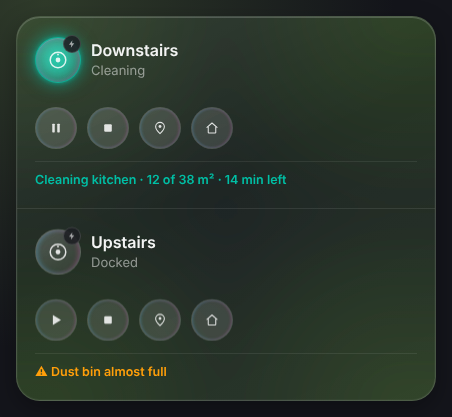

# Vacuum Robot Card

A frosted-glass ("Liquid Glass") styled vacuum widget for Home Assistant
(`custom:saugroboter-card`). Displays multiple `vacuum` entities as cards with control
buttons (start/pause, stop, locate, dock, optional skip-next-run) and an optional map/camera
preview.



## Installation

### HACS (custom repository)

1. HACS → the "⋮" menu (top right) → **Custom repositories**.
2. Add this repository's URL, category **Dashboard**.
3. Install **Vacuum Robot Card**, then add the resource if HACS doesn't do it automatically:
   - Settings → Dashboards → Resources → **+ Add resource**
   - URL: `/hacsfiles/liquid-glass-vacuum-roboter-card/saugroboter-card.js`
   - Type: **JavaScript Module**

### Manual

1. Copy `saugroboter-card.js` into `<config>/www/`.
2. Settings → Dashboards → Resources → **+ Add resource**
   - URL: `/local/saugroboter-card.js`
   - Type: **JavaScript Module**

## Configuration

```yaml
type: custom:saugroboter-card
entities:
  - entity: vacuum.roborock_s7
    name: Roborock S7 (Basement)
    map_camera: camera.roborock_map
    skip_boolean: input_boolean.roborock_skip_next_run
```

### Per-entity options (inside `entities`)

| Option | Type | Description |
|---|---|---|
| `entity` | string (required) | Vacuum entity ID |
| `name` | string | Overrides the friendly name |
| `map_camera` | string | Camera entity showing a live map/snapshot image, rendered inline |
| `map_rotate` | boolean | Rotates the map image 90° to better fit the available space |
| `skip_boolean` | string | `input_boolean` entity toggled by an optional "skip next run" button |
| `status_entity` | string | Optional sensor shown as a status line under the robot (e.g. room, progress or a maintenance hint). One line, tap to expand; text starting with ⚠ is shown in orange, and while the robot runs the line is shown in teal |

## Features

- Play/pause toggles between `vacuum.start` and `vacuum.pause` based on live state
- Stop, locate, and return-to-base buttons call the corresponding `vacuum` services
- Status text (Docked/Cleaning/Paused/Returning to Dock/Idle/Error/Unavailable) reflects the
  entity's current state, in German when Home Assistant runs in German
- The map area only appears when a `map_camera` is configured
- Icon + border glow around the avatar activates automatically while the vacuum is running
  (`cleaning`/`returning`)
- Icons are theme-adaptive (`currentColor` + `var(--primary-text-color)`), so they render
  correctly in both light and dark Home Assistant themes

## Theme variables

Like the other Liquid Glass cards, this card reads two optional CSS variables, so one theme can align all of them:

```yaml
# in your Home Assistant theme
lg-radius: 22px                          # corner radius of the glass panel
lg-backdrop: blur(22px) saturate(180%)   # blur/saturation behind the panel
```

Without them nothing changes. Options set on the card itself (e.g. `blur`) still win.

## Changelog

### 1.1.0
- Reads the optional theme variables `--lg-radius` and `--lg-backdrop` (see *Theme variables*).
- New `status_entity` option: a one-line status under each robot (tap to expand), orange for ⚠ hints, teal while running.
- Status texts follow the Home Assistant language (German/English).
- No empty "Map" placeholder when no `map_camera` is set.
- Renders into its own Shadow DOM, so its styles can't clash with other cards.
- Version banner in the browser console.

## License

MIT.

## Credits

Built iteratively in conversation with Claude (Anthropic) against a real Home Assistant dashboard,
then cleaned up for public release.
